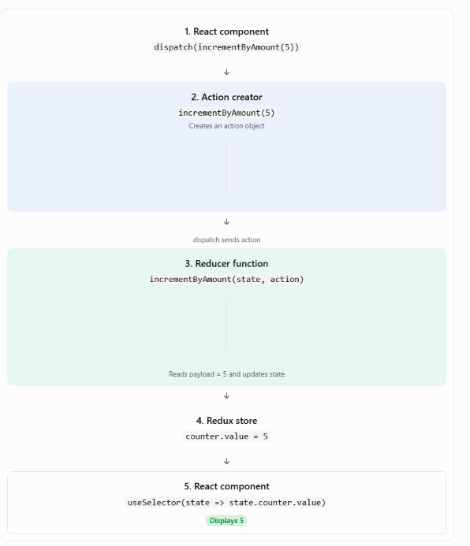

# React Redux Toolkit Tutorial – Less Boilerplate

## 1. Introduction

The recommended way to learn modern Redux is to use **Redux Toolkit (RTK)** with React-Redux hooks.

Avoid starting with traditional Redux, which requires manually writing:

- Action type constants
- Action creators
- Reducers with switch statements
- Immutable state update logic

Redux Toolkit simplifies all of this.

We will build a small counter application first, then extend the concepts to user management and API calls.

### What is Redux?

Redux is a centralised state management library.

It allows multiple React components to access and update shared application state without passing props through multiple component layers (prop drilling).

### Redux architecture

The basic flow is:

1. React component dispatches an action.
2. Redux reducer processes the action.
3. Redux store updates the state.
4. React component reads the updated state.
5. React re-renders when the selected state changes.

```text
React Component
      |
      | dispatch(action)
      v
Redux Slice / Reducer
      |
      | updates state
      v
Redux Store
      |
      | useSelector()
      v
React Component (re-render)
```

Think of Redux as a centralised state container.

---

## 2. Install dependencies

Install two packages:

```bash
npm install @reduxjs/toolkit react-redux
```

### What are these packages?

| Package          | Responsibility                                           |
| ---------------- | -------------------------------------------------------- |
| @reduxjs/toolkit | Creates the Redux store and slices with less boilerplate |
| react-redux      | Connects React components to the Redux store             |

---

## 3. Create a Redux slice

Create:

`src/features/counter/counterSlice.js`

A **slice** groups three things:

1. Initial state
2. Reducers that describe state updates
3. Automatically generated action creators

```javascript
import { createSlice } from "@reduxjs/toolkit";

const counterSlice = createSlice({
  name: "counter",

  initialState: {
    value: 0,
  },

  reducers: {
    increment: (state) => {
      state.value += 1;
    },

    decrement: (state) => {
      state.value -= 1;
    },

    incrementByAmount: (state, action) => {
      state.value += action.payload;
    },
  },
});

export const { increment, decrement, incrementByAmount } = counterSlice.actions;

export default counterSlice.reducer;
```

### 3a) Understanding createSlice()

`createSlice()` automatically generates _**action creators**_ and _**action types**_ based on the reducer names.

For example:

```javascript
increment();
decrement();
incrementByAmount(5);
```

These are automatically generated _**action creators**_

### 3b) What is action creator?

A) An _**action creators**_ is a function. Calling it returns the action object you already understand.

In your slice you never write that function. <span style="background:lightgrey;color:#222">createSlice</span> builds it from the reducer name and stores it on <span style="background:lightgrey;color:#222">counterSlice.actions</span>. This line pulls it out:

```JSX
export const { increment, decrement, incrementByAmount } = counterSlice.actions;
```

<span style="background:lightgrey;color:#222">incrementByAmount</span> here is the action creator. It looks like this:

```JSX
function incrementByAmount(payload) {
  return {
    type: "counter/incrementByAmount",
    payload: payload,
  };
}
```

So <span style="background:lightgrey;color:#222">incrementByAmount(5)</span> is a function call. Its return value is the action:

```JSX
{
  type: "counter/incrementByAmount",
  payload: 5
}
```

<span style="background:lightgrey;color:#222">increment</span> is the same kind of function, with no argument, because that case carries no data:

```JSX
function increment() {
  return {
    type: "counter/increment",
  };
}
```

<span style="background:lightgrey;color:#222">dispatch(incrementByAmount(5))</span> does two steps. <br>

- _First_ <span style="background:lightgrey;color:#222">incrementByAmount(5)</span> builds the action.
- _Second_ <span style="background:lightgrey;color:#222">dispatch</span> sends that action to the store. The reducer case with the same name is a different function: it receives the action and reads <span style="background:lightgrey;color:#222">action.payload</span>

#### MyFUPQ) on _Second_ above. I was not sure abt 'The reducer case with the same name is a different function: it receives the action and reads action.payload'

A)

**3b.1. Consider this Redux slice**

```JSX
import { createSlice } from '@reduxjs/toolkit';

const counterSlice = createSlice({
  name: 'counter',

  initialState: {
    value: 0
  },

  reducers: {
    incrementByAmount: (state, action) => {
      state.value += action.payload;
    }
  }
});

export const { incrementByAmount } = counterSlice.actions;

export default counterSlice.reducer;

```

Notice we have incrementByAmount in two places conceptually:

1. Inside reducers – the reducer function.
2. Inside counterSlice.actions – the automatically generated action creator.
   They are not the same function.

**3b.2. What happens when we call this?**

```JSX
dispatch(incrementByAmount(5));
```

Let's split it into two operations.

**Step A**: incrementByAmount(5)

This calls the automatically generated action creator.

It creates an action object:

```JSX
{
  type: 'counter/incrementByAmount',
  payload: 5
}
```

Notice that it does NOT update the Redux state.

It simply creates an object describing what should happen.

**Step B**: dispatch(...)

Now dispatch sends that action object to the Redux store.The Redux store identifies which reducer should handle that action based on its action type.The corresponding reducer function is executed.

**3b.3. How does the reducer receive the action?**

Remember this reducer?

```JSX
incrementByAmount: (state, action) => {
state.value += action.payload;
}
```

It receives two arguments:
| Argument | Meaning |
|---|---|
| `state` | Current state of this slice |
| `action` | The action object dispatched to Redux |

For our example:

```JSX
state = {
value: 0
};

And:
action = {
type: 'counter/incrementByAmount',
payload: 5
};
```

Therefore:

```JSX
state.value += action.payload;

Is effectively:
state.value = 0 + 5;

The updated state becomes:
{
value: 5
}
```

Immer handles producing the new immutable state.

**3b.4. Visualise the complete flow** <br>


### 3c) What is action payload?

You should get from 3b but still explaining below

Consider:

```javascript
incrementByAmount: (state, action) => {
  state.value += action.payload;
};
```

When we dispatch:

```javascript
dispatch(incrementByAmount(5));
```

The action object will conceptually look like:

```javascript
{
  type: 'counter/incrementByAmount',
  payload: 5
}
```

The reducer receives this action and accesses the passed value through `action.payload`.

### Why can we directly modify state?

In traditional Redux, reducers must not directly mutate the existing state.

Redux Toolkit uses **Immer** internally.

Immer allows us to write mutation-like code:

```javascript
state.value += 1;
```

But internally, it produces an immutable state update.

This means we get simpler code without sacrificing Redux's immutability principles.

---

### 3d) when store updates state does another component rerenders? also it uses state.counter.value. is that because "counter" is the name we gave inside slice?

A) Let's break it down

### 3d.1) When the Redux store updates, do other components re-render?

Not necessarily every component. Components using useSelector() are notified when the Redux store updates.React Redux compares the previous selected value with the new selected value using reference equality (===).

- If the selected value changes, the component re-renders.
- If the selected value remains the same, the component normally does not re-render because of that store update.
  For example:

  ```JSX
  function Counter() {
  const count = useSelector((state) => state.counter.value);
  return <h2>{count}</h2>;
  }

  function UserProfile() {
  const user = useSelector((state) => state.user);

  return <h2>{user.name}</h2>;
  }
  ```

  If the counter changes but the user state doesn't, Counter re-renders, but UserProfile normally doesn't.

### 3d.2) Why do we use state.counter.value?

A) Correct! counter is the name we gave when registering the slice reducer in the store.
For example, our slice:

```JSX
const counterSlice = createSlice({
  name: 'counter',
  initialState: {
    value: 0
  },
  reducers: {
    increment: (state) => {
      state.value += 1;
    }
  }
});
```

Now look at the store:

```JSX
const store = configureStore({
  reducer: {
    counter: counterSlice.reducer
  }
});
```

Here:

```JS
counter: counterSlice.reducer
```

The key counter determines the location of this slice's state in the Redux store.
So the overall state structure looks like this:

```JS
{
  counter: {
    value: 0
  }
}
```

That's why we access it using:

```JSX
const count = useSelector((state) => state.counter.value);
```

### 3d.3)What if we change the name?

Suppose we register the reducer like this:

```JS
const store = configureStore({
  reducer: {
    myCounter: counterSlice.reducer
  }
});
```

The state structure becomes:

```JS
{
  myCounter: {
    value: 0
  }
}
```

Now we must access it using:

```JS
const count = useSelector((state) => state.myCounter.value);
```

**Summary**
**Remember the distinction:**

| Name                                                    | Purpose                                                         |
| ------------------------------------------------------- | --------------------------------------------------------------- |
| `name: 'counter'` inside `createSlice`                  | Used to generate action type names, such as `counter/increment` |
| `counter: counterSlice.reducer` inside `configureStore` | Determines where the slice's state lives in the store           |
| `value`                                                 | Property inside the slice's initial state                       |

## 4. Create the Redux store

Create:

`src/app/store.js`

```javascript
import { configureStore } from "@reduxjs/toolkit";
import counterReducer from "../features/counter/counterSlice";

export const store = configureStore({
  reducer: {
    counter: counterReducer,
  },
});
```

That's the entire store configuration!

### understanding import 'counterReducer'. MyFUpQ)When we Cr store we import i.e "import counterReducer from "../features/counter/counterSlice"; "counterReducer " but slice(counterSlice above) in itself was exporting "export default counterSlice.reducer", i.e "counterSlice.reducer" and not "counterReducer"?

### A)

<span style="background-color: #f0f0f0;">counterReducer</span>
and <span style="background-color: #f0f0f0;">counterSlice.reducer</span> are the same function. The names differ because this is a default export, and the file that imports it chooses the local name.

In the slice, this line exports the reducer function with no fixed name attached:

```JS
export default counterSlice.reducer;
```

<span style="background-color: #f0f0f0;">counterSlice.reducer<span> is only the name of that function inside **counterSlice.js**. <span style="background-color: #f0f0f0;">export default </span> sends the function itself, not the label <span style="background-color: #f0f0f0;">.reducer </span>

In the store, this line receives that same function and gives it a new local name:

```JSX
import counterReducer from "../features/counter/counterSlice";
```

_counterReducer_ exists only in _store.js_. You could write <span style="background-color: #f0f0f0;"> import anything from "../features/counter/counterSlice"</span> and **anything** would still be that reducer. The name <span style="background-color: #f0f0f0;">counterReducer</span> is just a clear label for _“the reducer from the counter slice.”_

<span style="background-color: #f0f0f0;">configureStore</span> then registers it under the state key <span>counter</span>:

### Understanding the reducer property

```javascript
reducer: {
  counter: counterReducer;
}
```

This determines the shape of our global Redux state.

Conceptually, the store contains:

```javascript
{
  counter: {
    value: 0;
  }
}
```

The key `counter` is important because it determines how components access the state.

For example:

```javascript
state.counter.value;
```

### B) Q)MFUPQ on above. specially shape of our global Redux state.Code is what we saw earlier as well. (Grey bg below is question)

> conceptually store contains

```JSX
{
  counter: {
    value: 0;
  }
}
```

> Looking at above code, Is it safe to assume that store state looks like this because
> "counter" comes from _**key**_ used in store i.e in \_**configureStore**.If i had used another key there <br>
> then object will look differently.Right? <br>
> Also, is it necessary to have same name as name of slice?. In "slice" we had name as "counter" as well. <br>
> Addtionally, we get

```JS
{
 value:0
}
```

> because that is the intial state..is that right?. Code again below for quick ref

| `counterSlice.js`                                                                                                                                                                                                                                                                                                                                                                                                                                                                                                            | `store.js`                                                                                                                                                                                                                           |
| ---------------------------------------------------------------------------------------------------------------------------------------------------------------------------------------------------------------------------------------------------------------------------------------------------------------------------------------------------------------------------------------------------------------------------------------------------------------------------------------------------------------------------- | ------------------------------------------------------------------------------------------------------------------------------------------------------------------------------------------------------------------------------------ |
| <br>import { createSlice } from "@reduxjs/toolkit";<br><br>const counterSlice = createSlice({<br> name: "counter",<br> initialState: { value: 0 },<br> reducers: {<br> increment: (state) => {<br> state.value += 1;<br> },<br> decrement: (state) => {<br> state.value -= 1;<br> },<br> incrementByAmount: (state, action) => {<br> state.value += action.payload;<br> },<br> },<br>});<br><br>export const { increment, decrement, incrementByAmount } = counterSlice.actions;<br>export default counterSlice.reducer;<br> | <br>import { configureStore } from "@reduxjs/toolkit";<br>import counterReducer from "../features/counter/counterSlice";<br><br>export const store = configureStore({<br> reducer: {<br> counter: counterReducer,<br> },<br>});<br>` |

### Ans B)

**i). Where does counter come from?**
From your store.js:

```JS
export const store = configureStore({
reducer: {
 counter: counterReducer,
},
});
```

The key _counter_ determines where the reducer's state is stored.

So Redux maintains this conceptual state structure:

```JSX
{
  counter: {
    value: 0
  }
}
```

If you changed your store configuration to:

```JSX
export const store = configureStore({
  reducer: {
    myCounter: counterReducer,
  },
});
```

The state structure would become:

```JS
{
  myCounter: {
    value: 0
  }
}
```

And you would access it using:

```JS
const count = useSelector((state) => state.myCounter.value);
```

**ii) 2. Is it necessary to use the same name as the slice?**

**No**. They are independent.

In your _counterSlice.js_:

```JS
const counterSlice = createSlice({
  name: "counter",
  initialState: {
    value: 0,
  },
  // reducers...
});

```

Here, name: _"counter"_ is used by Redux Toolkit to generate action type names.

For **example**:

```JSX
counter/increment
counter/decrement
counter/incrementByAmount
```

In your _store.js:_

```JSX
reducer: {
counter: counterReducer,
}
```

Here, _counter_ determines the **location of the state**.

You can technically use different names:

```JS
// counterSlice.js
name: "counter"

// store.js
reducer: {
myCounter: counterReducer
}
```

Your action type would still be:

```JS
counter/increment
```

But your state selector would be:

```JS
state.myCounter.value
```

I recommend keeping the names the same for readability and consistency.

**iii) 3. Why do we get { value: 0 }?**

Exactly! It comes from your initialState.

```JS
initialState: {
  value: 0,
}
```

Redux uses this as the initial state for that slice.

When the application starts, your store state conceptually looks like:

```JS
{
counter: {
value: 0
}
}
```

After dispatching **increment()**, it becomes:

```JS
{
counter: {
value: 1
}
}
```

After dispatching **incrementByAmount(5)**, it becomes:

```JS
{
counter: {
value: 6
}
}
```

### Q)What if we have multiple slices?

We can simply register additional reducers:

```javascript
export const store = configureStore({
  reducer: {
    counter: counterReducer,
    users: usersReducer,
    cart: cartReducer,
  },
});
```

Redux Toolkit automatically combines these reducers.

We don't need to manually use `combineReducers()`.

---

## 5. Connect Redux to React using Provider

In `src/main.jsx`, wrap the application with Redux's `Provider`.

```jsx
import { StrictMode } from "react";
import { createRoot } from "react-dom/client";
import { Provider } from "react-redux";
import { store } from "./app/store";
import App from "./App";

createRoot(document.getElementById("root")).render(
  <StrictMode>
    <Provider store={store}>
      <App />
    </Provider>
  </StrictMode>,
);
```

### What does Provider do?

The `Provider` makes the Redux store available to all descendant React components.

Without it, components cannot use React-Redux hooks to access this store.

Think of Provider as the bridge between React and Redux.

---

## 6. Read and update Redux state in a React component

Create:

`src/features/counter/Counter.jsx`

```jsx
import { useSelector, useDispatch } from "react-redux";

import { increment, decrement, incrementByAmount } from "./counterSlice";

export default function Counter() {
  // Read data from Redux store
  const count = useSelector((state) => state.counter.value);

  // Get dispatch function
  const dispatch = useDispatch();

  return (
    <div>
      <h2>Count: {count}</h2>

      <button onClick={() => dispatch(increment())}>Increment</button>

      <button onClick={() => dispatch(decrement())}>Decrement</button>

      <button onClick={() => dispatch(incrementByAmount(5))}>Add 5</button>
    </div>
  );
}
```

Render it from `App.jsx`:

```jsx
import Counter from "./features/counter/Counter";

export default function App() {
  return <Counter />;
}
```

### Understanding useSelector()

```javascript
const count = useSelector((state) => state.counter.value);
```

`useSelector()` reads data from the Redux store.

Here:

- `state` represents the complete Redux state.
- `state.counter` accesses the counter slice.
- `state.counter.value` accesses the actual counter value.

Whenever the selected value changes, React-Redux causes the component to re-render.

### Understanding useDispatch()

```javascript
const dispatch = useDispatch();
```

`useDispatch()` gives us access to the Redux dispatch function.

We use it to send actions to Redux.

Example:

```javascript
dispatch(increment());
```

This sends an action to the Redux store.

The counter reducer processes the action and updates the state.

### Important distinction

```javascript
increment();
```

Creates an action object.

```javascript
dispatch(increment());
```

Dispatches that action to Redux.

Remember this distinction!

---

## 7. Understand the complete Redux flow

Let's follow what happens when a user clicks Increment.

### Step 1: User clicks the button

```jsx
<button onClick={() => dispatch(increment())}>Increment</button>
```

### Step 2: Action creator generates an action

```javascript
increment();
```

Conceptually generates:

```javascript
{
  type: "counter/increment";
}
```

### Step 3: Dispatch sends the action to Redux

```javascript
dispatch(increment());
```

### Step 4: Reducer processes the action

```javascript
increment: (state) => {
  state.value += 1;
};
```

### Step 5: Redux updates the store

Before:

```javascript
{
  counter: {
    value: 0;
  }
}
```

After:

```javascript
{
  counter: {
    value: 1;
  }
}
```

### Step 6: useSelector detects the updated value

```javascript
const count = useSelector((state) => state.counter.value);
```

The component receives the updated value and React re-renders it.

---

## 8. When should you use Redux?

You don't need Redux for every state variable.

| Scenario                                   | Suitable choice          |
| ------------------------------------------ | ------------------------ |
| Input field value                          | useState                 |
| Toggle or modal state                      | useState                 |
| Shared state used across many components   | Redux Toolkit can help   |
| Complex application-wide state transitions | Redux Toolkit            |
| Server data, caching and refetching        | RTK Query                |
| Simple state shared by nearby components   | Lift state up or Context |

### Example

Consider an application with:

- Header component
- User profile component
- Shopping cart component
- Checkout component

If multiple components need access to the logged-in user or shopping cart, Redux can provide a centralised state.

However, a simple input field value doesn't need Redux.

---

# 9. Practice: Build a User Management Feature

Now let's extend the counter example.

Instead of managing a number, we will manage an array of users.

This introduces:

- Arrays and objects in Redux
- Adding records
- Removing records
- Reading state
- Filtering data

### Task 1: Create usersSlice.js

Create:

`src/features/users/usersSlice.js`

Initial state:

```javascript
{
  users: [
    { id: 1, name: "John", active: true },
    { id: 2, name: "Sarah", active: false },
    { id: 3, name: "David", active: true },
  ];
}
```

Implement these reducers:

1. `addUser`
   - Accept a user object through `action.payload`.
   - Add it to the users array.

2. `removeUser`
   - Accept a user ID through `action.payload`.
   - Remove the matching user.

3. `toggleUserStatus`
   - Accept a user ID.
   - Toggle the user's active status.

### Task 2: Register the users slice

Update:

`src/app/store.js`

Add the users reducer alongside the counter reducer.

### Task 3: Create Users.jsx

Create a React component that:

1. Reads users using `useSelector()`.
2. Displays all users.
3. Uses `useDispatch()` to remove users.
4. Uses `useDispatch()` to toggle active status.

### Task 4: Filter active users

Use JavaScript's built-in `filter()` method to display only active users.

Hint:

```javascript
const activeUsers = users.filter((user) => user.active);
```

---

# 10. Important Redux Toolkit concepts to learn next

Once you understand the counter and users examples, move on to these topics.

| Concept               | Purpose                                           |
| --------------------- | ------------------------------------------------- |
| createSlice()         | Creates reducers and action creators              |
| configureStore()      | Creates and configures the Redux store            |
| useSelector()         | Reads state                                       |
| useDispatch()         | Dispatches actions                                |
| action.payload        | Carries data with an action                       |
| Immer                 | Simplifies immutable updates                      |
| createAsyncThunk()    | Handles asynchronous operations                   |
| RTK Query             | API fetching, caching and server-state management |
| createEntityAdapter() | Manages normalised collections of entities        |

## 11. Suggested project structure

For a growing React application:

```text
src/
│
├── app/
│   └── store.js
│
├── features/
│   ├── counter/
│   │   ├── counterSlice.js
│   │   └── Counter.jsx
│   │
│   └── users/
│       ├── usersSlice.js
│       └── Users.jsx
│
├── App.jsx
└── main.jsx
```

The feature-based structure keeps related Redux logic and React components together.

---

## 12. Key takeaways

1. Redux provides centralised application state management.
2. Redux Toolkit is the recommended modern way to write Redux.
3. `createSlice()` creates reducers and action creators automatically.
4. `configureStore()` creates the Redux store.
5. `Provider` makes the store available to React components.
6. `useSelector()` reads state.
7. `useDispatch()` dispatches actions.
8. `action.payload` carries data to reducers.
9. Immer allows mutation-like syntax while preserving immutable updates.
10. Use Redux for shared application state, not every local component state.

## Official documentation

- [Redux Toolkit Quick Start](https://redux-toolkit.js.org/tutorials/quick-start)
- [Redux Fundamentals](https://redux.js.org/tutorials/fundamentals/part-1-overview)
- [React-Redux Hooks](https://react-redux.js.org/api/hooks)
- [Redux Toolkit API](https://redux-toolkit.js.org/api/createSlice)

**Learning recommendation:** Get comfortable with `createSlice`, `configureStore`, `useSelector` and `useDispatch` first. Then move to asynchronous API calls with `createAsyncThunk` and RTK Query.
